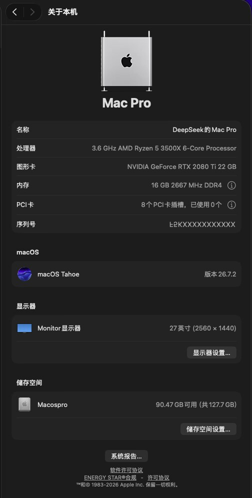

# 七彩虹 CVN B450M GAMING · Ryzen 5 3500X · RTX 2080 Ti — Hackintosh EFI

> macOS 26.7.2 Tahoe (25G332) 在 AMD B450 + NVIDIA Turing 上的可用配置
> 已连续运行验证，音频 / 显卡加速 / 有线网络 / 睡眠 均可工作

[硬件配置](#硬件配置) · [快速开始](#快速开始) · [已知限制](#已知限制) · [文档索引](#相关文档) · [**下载完整包**](https://github.com/sjqwert/cvn-b450m-hackintosh/releases/latest)

---

## 这是什么

一套在 **AMD Ryzen 平台 + NVIDIA RTX 20 系显卡** 上运行 macOS 26 (Tahoe) 的 OpenCore 配置。

大多数人认为这条路走不通：macOS 从 10.14 Mojave 起就不再支持 NVIDIA 显卡。这套配置能跑起来，靠的是三点：

1. **AMD 内核补丁**（algrey / Shaneee / CaseySJ 等社区多年积累的 `cpuid` 与 `mtrr` 补丁）
2. **第三方 NVIDIA 驱动**（NullMoth，Non-Apple 移植，见 [docs/05-nvidia.md](docs/05-nvidia.md)）
3. **macOS 26 移除 AppleHDA 后的音频替代方案**（SimpleHDA，见 [docs/03-audio.md](docs/03-audio.md)）

它能满足日常使用和轻度图形工作，但**不是一台 Mac**。硬件层面的限制（尤其是 256 MB 的 BAR1 窗口）无法通过配置解决，详见 [已知限制](#已知限制)。

<p align="center">
  
  <br>
  <sub>MacPro7,1 · macOS 26.7.2 Tahoe (25G332) · 序列号已抹去</sub>
</p>

### 什么时候不该用这个仓库

符合下面任意一条，建议直接关掉这个页面：

- **想省事。** 这条路已经没什么人走了，这套配置是在旧路上继续凿出来的。装完不等于能用，能用不等于稳定。
- **要跑需要 Secure Boot 的软件。** 反作弊游戏、部分企业 VPN，这套配置永远过不去。
- **靠它吃饭。** [下面列的两条硬缺陷](#已知限制)决定了它不适合当主力剪辑 / 渲染机。真要生产力，一张 RX 6600 比折腾一个月有用。
- **怕承担风险。** 刷 BIOS、改 EFI 都可能让机器变砖，而这块主板**没有双 BIOS**。

---

## 硬件配置

| 部件 | 型号 | 状态 |
|---|---|---|
| CPU | AMD Ryzen 5 3500X（Zen 2，6C/6T） | ✅ 需内核补丁 |
| 主板 | 七彩虹 CVN B450M GAMING V14（B450，mATX） | ✅ |
| 内存 | 16 GB DDR4-2667 双通道 | ✅ |
| 显卡 | NVIDIA RTX 2080 Ti 22 GB（TU102，`0x1e04`） | ⚠️ 第三方驱动 |
| 声卡 | Realtek ALC662 rev3 | ✅ layout-id 15 |
| 有线网卡 | Realtek RTL8111 | ✅ |
| 蓝牙 | Broadcom BCM4350C2（UART） | ⚠️ 见 [docs/04](docs/04-bluetooth.md) |
| 存储 | NVMe SSD | ✅ NVMeFix |
| 引导 | OpenCore（Dortania 构建 2026-10-30） | ✅ |
| 系统 | macOS 26.7.2 Tahoe · Build 25G332 | ✅ |

> 机型伪装为 **MacPro7,1**。这个机型没有核显、没有 T2，是 AMD 平台最省事的选择。

### 功能状态

| 功能 | 状态 | 说明 |
|---|---|---|
| 开机 / 关机 / 重启 | ✅ | |
| 显卡硬件加速（Metal 3） | ✅ | 依赖 NullMoth 驱动 |
| HDMI / DP 音频输出 | ✅ | 显卡自带，4 路 |
| 板载声卡 ALC662 | ✅ | SimpleHDA + `alcid=15` |
| 有线网络 | ✅ | AppleVTD 兼容 |
| 睡眠 / 唤醒 | ✅ | |
| USB 端口映射 | ✅ | USBToolBox + UTBDefault |
| 蓝牙 | ⚠️ | 芯片识别为 BCM_4350C2，功能待完善 |
| AirDrop / 隔空投送 | ❌ | 需要支持的 Wi-Fi + 蓝牙组合卡 |
| iMessage / FaceTime | ⚠️ | 需自行生成三码，见 [docs/08](docs/08-smbios.md) |
| 硬件视频编解码 | ⚠️ | 首次查询返回 NO，见 [docs/05](docs/05-nvidia.md) |

---

## 快速开始

### 前提

- **拿到本仓库的文件** —— [下载完整包](https://github.com/sjqwert/cvn-b450m-hackintosh/releases/latest)（zip，约 12 MB，含 EFI + 文档 + 工具），或 `git clone`
- 一块 **≥ 512 MB 的 U 盘**（FAT32）
- 已在另一台电脑上准备好 macOS 安装盘（本仓库只含引导，不含系统）
- 会改 BIOS 设置，能接受"刷坏了要拆机"的风险

> 完整包和 clone 的内容一致。包内 `EFI/` 目录可以直接拷进 ESP；**NVIDIA 驱动本体与三码不在包内**，需自行准备，见 [docs/05](docs/05-nvidia.md) 与 [docs/08](docs/08-smbios.md)。

### 第 1 步：BIOS 设置

开机按 `Del` 进 BIOS，按下面逐项设置。**这一步做错，后面全部白费。**

```
Advanced Mode → Advanced → ACPI Settings
    ACPI Auto Configuration ............ Disabled

Advanced Mode → AMD CBS → NBIO Common Options
    4G以上 MMIO 资源分配 (Above 4G Decoding) ... Enabled     ← 必须
    Re-Size BAR Support .................... Enabled        ← 必须

Advanced Mode → 主板芯片组 → PCH 设置
    SATA Mode .............................. AHCI

Boot
    Fast Boot .............................. Disabled
    CSM Support ............................ Disabled
    Secure Boot ............................ Disabled
    Boot Mode .............................. UEFI only

    BIOS Write Protect ..................... Disabled       （如有此项）
```

> **Above 4G Decoding 与 Re-Size BAR 是显卡能驱动的必要条件。**
> 关掉任意一项，开机会黑屏。这一点在本平台上反复验证过。

### 第 2 步：把 EFI 拷到 U 盘

U 盘格式化为 **FAT32**、分区表 **GPT**，把本仓库的 `EFI/` 整个目录拷到根目录：

```
/EFI
  /BOOT
    BOOTx64.efi
  /OC
    OpenCore.efi
    config.plist
    ACPI/ Drivers/ Kexts/ Resources/ Tools/
```

### 第 3 步：生成你自己的三码

**不要直接用仓库里的 `config.plist` 开 iMessage。** 里面的序列号是占位符。

用 [GenSMBIOS](https://github.com/corpnewt/GenSMBIOS) 生成 MacPro7,1 的 `SystemSerialNumber` / `MLB` / `SystemUUID`，再用 [MACSerial](https://github.com/acidanthera/OpenCorePkg) 或直接取网卡 MAC 填 `ROM`。

详见 [docs/08-smbios.md](docs/08-smbios.md)。

### 第 4 步：启动

1. U 盘插上，开机按 `F11`（或 `F8`）调出启动菜单，选 U 盘
2. OpenCore 菜单里选 `Install macOS` 或已装好的系统盘
3. 首次启动会走 `-v` 详细模式，看滚动日志

能进桌面后，把 `EFI/` 拷到系统盘的 ESP 分区，让机器脱离 U 盘独立启动。

### 第 5 步（可选）：安装系统侧补丁

`tools/` 里是几个让体验完整的辅助脚本，**不是必须的**：

| 工具 | 作用 |
|---|---|
| `tools/guard/` | 开机自动恢复音频输出设备 + 呈现模式 |
| `tools/diagnostics/` | 显卡通道体检、呈现模式检查、显存占用采样 |
| `tools/extras/` | 亮度条、摄像头预览（源码） |

用法见 [tools/README.md](tools/README.md)。

---

## 目录结构

```
.
├── EFI/                        OpenCore 引导（整体拷入 ESP 根目录）
│   ├── BOOT/BOOTx64.efi
│   └── OC/
│       ├── config.plist        ← 三码已脱敏，需自行生成
│       ├── ACPI/               4 个 SSDT
│       ├── Drivers/            OpenRuntime / HfsPlus / apfs_aligned / ResetNvramEntry
│       ├── Kexts/              17 个内核扩展
│       ├── Resources/          OpenCanopy 图标与字体
│       └── Tools/NullMothSafe.efi   黑屏急救工具
├── docs/                       分专题文档
│   ├── 01-hardware.md          硬件与兼容性分析
│   ├── 02-bios.md              BIOS 逐项设置与原理
│   ├── 03-audio.md             ALC662 + SimpleHDA（macOS 26 无 AppleHDA 的解法）
│   ├── 04-bluetooth.md         蓝牙现状与换卡建议
│   ├── 05-nvidia.md            NVIDIA 驱动、boot-args、性能实测
│   ├── 06-known-issues.md      已知限制与根因
│   ├── 07-troubleshooting.md   黑屏 / 卡代码 / 启动项丢失的救法
│   ├── 08-smbios.md            三码生成
│   └── 09-kexts.md             组件清单与加载顺序
├── tools/                      系统侧脚本
└── scripts/                    辅助脚本（挂载 ESP 等）
```

---

## 关键配置说明

### boot-args

```
-v keepsyms=1 debug=0x100
alcid=15
nvfb=1 nvaccel=1 nvfbheads=4 -nvkmsnosmooth gfxrst=4
nvrmsettle=10000 nvfbhidpi=1 -nvrmnobootscreen
amfi_get_out_of_my_way=0x1 amfi=0x80 ipc_control_port_options=0 -amfipassbeta
revpatch=sbvmm,cpuname
npci=0x2000
```

| 参数 | 作用 |
|---|---|
| `-v keepsyms=1 debug=0x100` | 详细模式 + 保留符号 + 禁用看门狗。**调好之后可以去掉** |
| `alcid=15` | AppleALC 的 ALC662 layout-id |
| `nvfb=1` `nvaccel=1` | 启用 NVIDIA 帧缓冲与硬件加速 |
| `nvfbheads=4` | 显示头数量（驱动默认值，实测改成 2 无任何效果） |
| `-nvkmsnosmooth` | 关闭驱动的逐帧平滑，降低卡顿感 |
| `gfxrst=4` | 显卡复位策略 |
| `nvrmsettle=10000` | 驱动初始化等待 10 秒，避免开机时序竞争 |
| `nvfbhidpi=1` | 允许 HiDPI 分辨率 |
| `-nvrmnobootscreen` | **关键**。不把 UEFI 开机画面快照进 BAR1，省出约 15 MB |
| `amfi_get_out_of_my_way=0x1` `amfi=0x80` | 放行未签名 kext（AMFIPass 配套） |
| `ipc_control_port_options=0` | 修正 AMD 平台的 IPC 端口 |
| `revpatch=sbvmm,cpuname` | RestrictEvents：上报真实内存大小 + 自定义 CPU 名称 |
| `npci=0x2000` | 修正 PCI 配置空间扫描 |

`-nvrmnobootscreen` 值得单独说明：那张开机画面快照是 `2560×1440×4 = 14,745,600` 字节，正好等于一帧。BAR1 预算本来就被占满，关掉它才腾得出一帧给 WindowServer 做零拷贝翻页。详见 [docs/05](docs/05-nvidia.md)。

### 安全设置

```
SecureBootModel       = Disabled
Vault                 = Optional
csr-active-config     = 0x0A43
```

`0x0A43` 展开：

| 位 | 含义 | 值 |
|---|---|---|
| `1<<9` | 允许未批准 kext | 开 |
| `1<<11` | 允许未认证根卷 | 开 |
| `1<<1` | 关闭文件系统保护 | 开 |
| `1<<6` | 允许无限制 NVRAM | 开 |
| `1<<3` | 内核调试器 | 关 |
| `1<<5` | DTrace 限制 | 关（保留限制） |

SIP 处于这种半开状态是必要的：NVIDIA 驱动是未签名 kext，必须放行。**代价是系统完整性保护不完整**，这也是本配置不适合当生产机的另一个原因。

### 内核补丁

`Kernel → Patch` 里有 27 条，全部来自 AMD OSX 社区。删不得：

- `_cpuid_set_info` · GenuineIntel → AuthenticAMD
- `_cpuid_set_cpufamily` · 强制 `CPUFAMILY_INTEL_PENRYN`
- `_cpuid_set_cache_info` / `_cpuid_set_generic_info` · 绕开 Intel 专有 MSR
- `_commpage_populate` / `_i386_init` · 移除 `rdmsr`
- `_mtrr_update_action` · 修正 PAT（内存类型，显卡稳定性的关键）
- `IOPCIFamily` · 关闭 10-bit tag（Tahoe 上必须）
- `thread_quantum_expire` 等 · 调度器时序修正

### Quirks 要点

| 位置 | 项 | 值 | 为什么 |
|---|---|---|---|
| Booter | `ResizeAppleGpuBars` | `-1` | **不要设 0**。设 0 会把 BAR1 压回 64 MB，NVIDIA 驱动需要 ≥ 256 MB，直接黑屏 |
| Booter | `RebuildAppleMemoryMap` | 开 | AMD 平台必需 |
| Booter | `SyncRuntimePermissions` | 开 | 同上 |
| Kernel | `ProvideCurrentCpuInfo` | 开 | 让系统读到正确的 CPU 拓扑 |
| Kernel | `CustomSMBIOSGuid` | 开 | 配合 `UpdateSMBIOSMode = Custom` |
| UEFI | `ResizeGpuBars` | `-1` | 固件侧同理，让固件决定 BAR 大小 |
| UEFI | `RequestBootVarRouting` | 开 | 保护 `Boot####` 变量不被系统改写 |
| UEFI | `ReleaseUsbOwnership` | 开 | 交接 USB 控制器 |

---

## 已知限制

**先说结论**：这台机器的天花板在硬件，不在配置。下面 7 条里，**4 条无解、2 条要换硬件、1 条要加内存**。

每一条都有实测证据和失败尝试记录，完整推导见 [docs/06-known-issues.md](docs/06-known-issues.md)。

### 1. BAR1 只有 256 MB —— 最影响体验

macOS 的 `IOFramebuffer` 要求扫描输出缓冲必须落在 **CPU 可映射的 BAR1** 里，而这块卡的 BAR1 只有 256 MB：

```
256 MB = 扫描缓冲 56.5 MB + 加速器预算 183.5 MB + 守卫 16 MB
```

账刚好平，一个字节不剩。后果：

- 所有显示更新走「拷贝」而非「翻页」（`nvaccel_iop_flip` 恒为 0）
- 每秒约 145 次整帧显存申请失败
- 拖动窗口、滚动列表发涩

**为什么改不动**：限制不在 BIOS，在 **Turing VBIOS** —— 它的 ReBAR 能力位掩码只有 `0x1c0`，对应 64 / 128 / 256 MB 三档。NVIDIA 从未给 20 系发放支持大 BAR 的固件（官方 ReBAR 自 Ampere 才开始）。

试过并失败的：BIOS 开 Re-Size BAR、移除 `npci=0x2000`、`sysctl` 调 `nvrmfb_vram_budget_bytes`（`read only`，root 也不行）、改 `ResizeAppleGpuBars`、往固件里注入 NvStrapsReBar 模块（被 Secure Flash 签名拦下，零写入）。

**出路只有两条**：

- **A.** 改 VBIOS 扩能力位（Windows + `nvflash`，刷坏即变砖）
- **B.** 加一张 macOS 原生支持的 AMD 卡做显示输出，RTX 只做计算

### 2. 硬件解码首次查询恒返回 NO —— 第二影响

每个进程**第一次**调用 `VTIsHardwareDecodeSupported()` 恒返回 `NO`：

```
单独查询 HEVC（首次）    → NO        ← bug 在此
先查 H.264，再查 HEVC    → HEVC = YES
```

预热后的真实能力是 `H.264 = YES`、`HEVC = YES`、`ProRes = NO`、`VP9 = NO`、`AV1 = NO`。但 Chrome、Safari、QuickTime、DaVinci、Premiere 都只查一次，于是全部误判「无硬解」退回 CPU 软解 —— Ryzen 5 3500X 只有 6 核 6 线程，软解 4K 直接满载。

**这是「看视频卡」的第一原因，比 BAR1 更致命。** 驱动里解码器是存在的（`libnvdec_h264.dylib`），缺陷在注册时机，用户侧改不了。绕法：素材转 HEVC，或用代理剪辑。

### 3. Secure Boot 必须永久关闭

未签名 kext（NVIDIA 驱动、SimpleHDA）与 Secure Boot 不可共存。本配置：`SecureBootModel = Disabled`、`csr-active-config = 0x0A43`。

代价是明确的：

- 需要 Secure Boot 的软件用不了（部分反作弊游戏、企业 VPN）
- macOS 的 Sealed Volume 完整性校验失效
- 系统更新有可能改坏自定义 kext，**更新前请先备份 EFI**

### 4. 主板没有双 BIOS，刷坏只能拆机

七彩虹 CVN B450M GAMING V14 只有**一颗** SPI flash，没有 FlashBack 按钮。

刷坏后只有两条救法：① CH341A 编程器夹 SPI 芯片（需拆机，芯片位置在显卡下方）；② UEFI Shell 里用 AFU 刷回 —— **前提是还能 POST**。

这也是为什么本仓库作者在尝试刷修改版 BIOS 之前，先完整 dump 了一份 16 MB 原厂固件存档。

### 5. 蓝牙未工作，AirDrop 不可能

BCM4350C2 被识别为 `BCM_4350C2`，但 `State: Off`、`Firmware v0 c0`（固件未上传）。见 [docs/04-bluetooth.md](docs/04-bluetooth.md)。

AirDrop / 隔空投送 / 接力 需要 **Wi-Fi + 蓝牙组合卡**，这块主板上没有 Wi-Fi，所以这些功能全部不可用，不是配置问题。

另外，**CSR8510 一类廉价 USB 蓝牙棒在 macOS 上永远不可能工作** —— 系统里没有驱动它们的代码，已经九年了。

### 6. 着色器冷编译慢

每个 kernel 编译 5.9–8.8 ms，真实工程数千个材质变体，首次打开会冻结数十秒。这是 Metal → SPIR-V → Vulkan → NVK → SASS 翻译层的固有开销，原生驱动没有这一层。

跨进程缓存有效（第二次快约 115 倍），**所以绝对不要清 `~/.cache/mesa_shader_cache`**。

### 7. 内存 16 GB 偏小

压缩页已达 125,100，渲染软件会触发内存压缩换页，表现为「切后台再切回来要等」。

**这是唯一还有明确收益的硬件升级** —— 加到 64 GB。

---

### 看起来能修、其实修不了

| 你可能想这么干 | 实际结果 |
|---|---|
| 在 BIOS 里打开 Re-Size BAR 扩大 BAR1 | 开了也是 256 MB，限制在 Turing VBIOS 能力位 |
| 刷修改版 BIOS 塞入 ReBAR 模块 | AMI Secure Flash 签名校验；`/p /b /x /k /l`、`/CAPSULE`、`/RECOVERY` 三种策略全部 `18 - Error: Secure Flash Rom Verify fail`，**零写入** |
| 在系统里用 flashrom 直接刷 SPI | 固件里的 `AmdSpiRomProtectDxe` 把 SPI 控制器锁成只读，`SpiAccessMacRomEn` 复位后无法再置位 |
| 插个 CSR8510 USB 蓝牙棒 | macOS 无驱动，且已无望 |
| 打开 Secure Boot 去玩反作弊游戏 | 与未签名 kext 不可共存 |
| 等 NVIDIA 恢复官方 macOS 驱动 | 不会发生，Apple 从 10.14 起就断了 |

### 一览

| # | 限制 | 影响 | 能修吗 | 怎么办 |
|---|---|---|---|---|
| 1 | BAR1 仅 256 MB | 高 | ❌ | 换 AMD 卡 / 改 VBIOS（高危） |
| 2 | 硬解首查返回 NO | 高 | ❌ | 素材转 HEVC、代理剪辑 |
| 3 | Secure Boot 关闭 | 中 | ❌ | 不可能 |
| 4 | 无双 BIOS | 中 | ❌ | 硬件事实，靠备份自救 |
| 5 | 蓝牙 / AirDrop | 中 | ⚠️ | 换 BCM94360 组合卡 |
| 6 | 着色器冷编译 | 低 | ⚠️ | 保留缓存 |
| 7 | 内存 16 GB | 低 | ✅ | 加内存 |

---

## 免责声明

**这是一个实验性配置，不是产品。**

- 刷 BIOS、改 EFI 有**变砖**风险。本仓库作者不对任何数据丢失、硬件损坏负责。
- `config.plist` 里的三码是占位符。**填入他人序列号可能导致 Apple ID 被封**。
- 本仓库**不分发** NVIDIA 驱动本身（NullMoth 为闭源第三方组件），只提供配置参数。
- macOS 的使用需遵守 Apple 的最终用户许可协议。黑苹果在多数司法辖区处于法律灰色地带，请自行判断。
- 不提供 Apple 服务（iMessage、iCloud、App Store）的可用性保证。

**如果你在找一台稳定工作的 Mac，请买一台 Mac。**

---

## 致谢

这套配置站在很多人的肩膀上：

| 项目 | 作者 | 用途 |
|---|---|---|
| [OpenCorePkg](https://github.com/acidanthera/OpenCorePkg) | Acidanthera | 引导器 |
| [Lilu](https://github.com/acidanthera/Lilu) / [WhateverGreen](https://github.com/acidanthera/WhateverGreen) / [VirtualSMC](https://github.com/acidanthera/VirtualSMC) | Acidanthera | 内核补丁框架 |
| [AppleALC](https://github.com/acidanthera/AppleALC) | Acidanthera | 声卡 |
| [RestrictEvents](https://github.com/acidanthera/RestrictEvents) | Acidanthera | CPU 名称与内存上报 |
| [NVMeFix](https://github.com/acidanthera/NVMeFix) | Acidanthera | NVMe 电源管理 |
| [RealtekRTL8111](https://github.com/Mieze/RTL8111_driver_for_OS_X) | Mieze | 有线网卡 |
| [USBToolBox](https://github.com/USBToolBox/tool) | USBToolBox | USB 映射 |
| [AMFIPass](https://github.com/dhinakg/AMFIPass) | dhinakg | AMFI 放行 |
| [CtlnaAHCIPort](https://github.com/outtaym/CtlnaAHCIPort) | outtaym | AHCI 端口 |
| AMD 内核补丁 | algrey / Shaneee / CaseySJ / XLNC / Visual / Zormeister | `cpuid`、`mtrr`、`IOPCIFamily` |
| [AMD OSX](https://amd-osx.com/) | 社区 | 全部 AMD 平台知识的来源 |
| NullMoth / SimpleHDA | laobamac | NVIDIA 驱动、macOS 26 音频栈 |

本仓库自身的配置、文档与脚本以 **MIT** 协议发布，第三方组件的归属与协议逐项列在 [THIRD-PARTY.md](THIRD-PARTY.md)。

---

## 相关文档

- [硬件与兼容性](docs/01-hardware.md)
- [BIOS 设置](docs/02-bios.md)
- [音频：macOS 26 没有 AppleHDA 怎么办](docs/03-audio.md)
- [蓝牙](docs/04-bluetooth.md)
- [NVIDIA 显卡：驱动、参数与实测性能](docs/05-nvidia.md)
- [已知限制与根因](docs/06-known-issues.md)
- [故障排查](docs/07-troubleshooting.md)
- [三码生成](docs/08-smbios.md)
- [组件清单](docs/09-kexts.md)
- [第三方组件与协议](THIRD-PARTY.md)
- [工具说明](tools/README.md)
